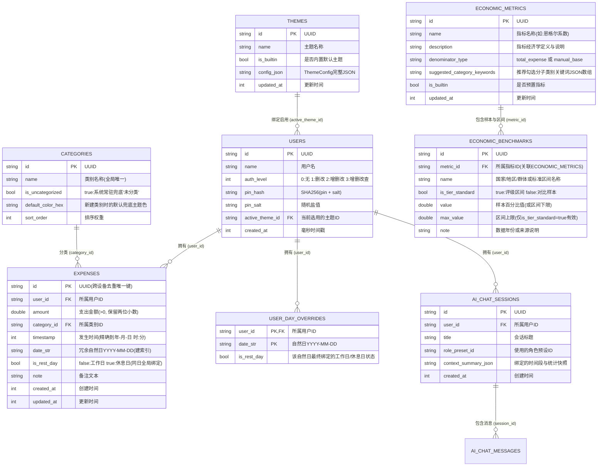

# 本地多用户深度定制记账 App —— 最终完整开发规格说明书 (AI-Ready Master Spec)

> [!IMPORTANT]
> **致代码生成 AI 的最高指令**：
> 本文档是经过深度推敲定稿的**零歧义工程规范**。请严格按照本文档定义的技术栈、数据库 Schema、权限状态机、UI 渲染公式、双引擎经济学模型 API 生成协议、ZIP 导入导出规范，以及**文末附录中硬编码的全部预置种子数据**，编写完整、可直接编译运行的 Flutter 项目代码。严禁省略任何功能模块，严禁使用 `TODO` 或空白占位符。

---

## 1. 项目概述与跨平台技术底座

### 1.1 核心定位
一款运行于 **Android**（且一套代码完全兼容编译 **iOS** 与 **Windows 桌面端**）的**纯本地、多用户分级权限、深度自定义视觉主题、支持宏观经济学模型对比（含 API 动态拉取/生成经济学统计模型）与大模型对话分析**的支出记账软件。
- **只统计支出**：专注于支出记录、分类占比、时间趋势、工作日/休息日消费结构及经济学模型洞察。
- **离线优先 + API 赋能**：所有账单、主题图片、经济学模型均 100% 存储在本地 SQLite 与本地文件目录；仅在用户主动触发「AI 账单分析」或「通过 API 拉取/生成经济学统计模型」时发起网络请求。

### 1.2 技术栈与推荐依赖 (`pubspec.yaml`)
- **框架版本**：Flutter 3.x (Dart 3.x)，Material 3。
- **跨平台硬性约束**：所有 SQLite 操作、文件读写、图片裁剪压缩、ZIP 打包解包必须同时兼容 **Android / iOS / Windows**，禁止耦合单一平台的私有原生代码。
- **核心依赖清单**：
  - 状态管理：`flutter_riverpod` (`^2.5.1`)
  - 本地数据库：`drift` + `sqlite3_flutter_libs`（或 `sqflite` + `sqflite_common_ffi`，Windows 端自动初始化 `sqfliteFfiInit()`）
  - 图表绘制：`fl_chart`（环形饼图、柱状图、折线图、经济学分位横向对比条形图）
  - 图片选取、裁剪与压缩：`file_picker` / `image_picker` + `crop_your_image`（纯 Dart 跨平台比例裁剪器）+ `image` / `flutter_image_compress`（支持分辨率缩放与 JPEG 质量压缩，并兼容 Windows 纯 Dart 降级处理）
  - 压缩包处理：`archive`（纯 Dart 实现 `.zip` 打包与解包）+ `path_provider` + `share_plus`
  - 加密与哈希：`crypto`（用于超级管理员主 PIN 与各用户 PIN 码的 `SHA-256 + Salt` 哈希校验）
  - 网络与 SSE 流式通讯：`dio` 或 `http`（支持 OpenAI 兼容 `/v1/chat/completions` 的 `stream: true` 流式解析及 World Bank REST API 拉取）
  - Markdown 渲染：`flutter_markdown`
  - 基础工具：`uuid`、`intl`、`shared_preferences`

---

## 2. 数据库 Schema 与全局/用户隔离设计

本地 SQLite 数据库共包含 **8 张核心表**（加上 `SharedPreferences` 存储全局轻量配置）：



### 2.1 全局配置项 (`app_settings` / `SharedPreferences`)
全软件所有用户共享以下全局配置：
- `master_pin_hash` & `master_pin_salt`：软件级**超级管理员主密码（4~6位纯数字 PIN 码）**的哈希值与盐值。
- `currency_symbol`：全局货币符号（默认 `"¥"`，支持切换 `"$"`、`"`€`"`、`"£"`、`"无符号"` 或自定义输入任意前缀字符）。
- `llm_base_url`、`llm_api_key`、`llm_model_name`：全局共享的大模型 API 配置（配置一次，所有用户共用）。
- `ai_role_presets_json`：全局共享的 AI 角色预设列表（内置 3 个角色 + 用户自定义新增角色）。
- `current_active_user_id`：上次使用/当前所在的用户 ID。

### 2.2 核心数据关联与业务约束
1. **同日「工作日 / 休息日」全局绑定规则**：
   - 对同一个用户（`user_id`）而言，**同一个自然日（`date_str: YYYY-MM-DD`）的所有账单强制共享同一个「工作日/休息日 (`is_rest_day`)」状态**。
   - 判定优先级：先查 `user_day_overrides` 表中是否存在 `(user_id, date_str)` 记录；若存在则直接采用该状态；若不存在，则按日历「周六/周日 = 休息日 (`true`)，周一至周五 = 工作日 (`false`)」自动预判。
   - **联动更新**：当用户在新增或编辑某天（`YYYY-MM-DD`）的任意一条账单时切换了「工作日/休息日」开关，保存时必须在同一事务中：① 更新 `user_day_overrides(user_id, date_str, is_rest_day)`；② 批量将该用户在该自然日（`date_str`）名下的**所有账单**的 `is_rest_day` 同步更新为相同状态。
2. **全局类别与「未分类」常驻兜底规则**：
   - `categories` 表全软件共享。初始包含：**「吃的」「用的」「玩的」**（`is_uncategorized = false`，**均允许用户自由重命名或删除**）以及 **「未分类」**（`is_uncategorized = true`）。
   - **「未分类」的地位**：「未分类」既是常驻固定类别（仅禁止被删除或改名），也是其他类别被删除后的承接池。用户在日常记账时**可以直接主动选择「未分类」**；在主题工坊中**也可以为「未分类」自定义专属主题色与卡片背景图**。
   - **删除类别事务**：删除任意非兜底类别时，必须在同一事务中将 `expenses` 表里所有 `category_id == 被删类别ID` 的账单（跨所有用户）统一更新为「未分类」的 `id`，然后再删除该类别并清理各主题中的对应键值。
   - **重命名与新建类别联动**：
     - `ThemeConfig.categoryStyles` 在数据库内部以 `category_id`（或重命名时同步刷新所有 `themes.config_json` 中的类别键）关联，确保**重命名类别后绝不丢失任何已保存主题中为该类别配置的背景图与主题色**。
     - 新建自定义类别时，允许用户选取一个初始默认主题色 `default_color_hex`（默认从高辨识度色板自动分配），作为尚未单独配置该类别的旧主题的兜底 `themeColor`。

---

## 3. 超级管理员主 PIN 码与 4 级多用户权限状态机

### 3.1 首次启动强制设置「超级管理员主密码 (Master PIN)」
- **触发时机**：App 首次安装启动时，进入主界面前**强制弹出「设置超级管理员主密码」引导页**，要求用户设定一个 **4~6 位纯数字主 PIN 码**（需输入两次确认）。
- **超级管理员主 PIN 码的两大特权**：
  1. **万能钥匙直接解锁**：在软件内**任何子用户的数字 PIN 码验证弹窗或冷启动锁屏界面**中，用户无需切换键盘，直接输入超级管理员数字主 PIN 码即可通过校验（校验逻辑：`verifyPin(input, targetUser) || verifyMasterPin(input)`），直接解锁通行！
  2. **强制重置与整机管理**：在【设置 -> 多用户管理】中点击任意用户的「忘记密码/重置 PIN 码」，或执行「导出/导入整机全量备份包 (`.fullbackup.zip`)」时，验证超级管理员主 PIN 码即可强制重置该用户的密码并完整保留其账单数据。

### 3.2 子用户 4 级密码权限与会话锁定生命周期
每个用户可独立设置 4 种安全级别之一（设为级别 1/2/3 时需设置该用户的 4~6 位纯数字 PIN 码）：
- **会话解锁状态 (`isSessionUnlocked`)**：当前用户一旦输入正确 PIN 码（或超级管理员主 PIN 码），`isSessionUnlocked` 变为 `true`，后续操作不再重复弹窗；当发生 **① 点击顶栏「锁定/登出」按钮**、**② 切换到其他用户**、**③ 退出/关闭 App 进程** 时，立即重置为 `false`。
- **跨用户越权防护铁律**：若在【多用户管理】或【数据导出】中操作的目标用户是**另一个设有密码的用户 B**（非当前已解锁用户），必须弹出验证**目标用户 B 的 PIN 码（或超级管理员主 PIN 码）**，绝不允许利用无密码用户 A 越权修改、删除或导出有密码用户 B 的数据。

| 操作范围 | 级别 0：`无` (打开即用) | 级别 1：`删改` | 级别 2：`增删改` | 级别 3：`增删改查` |
| :--- | :---: | :---: | :---: | :---: |
| **冷启动进入 / 切换到该用户 / 浏览账单、统计、洞察** | 直接放行 | 直接放行 | 直接放行 | 🔒 **需验证 PIN 码** |
| **新增记账条目 / 发起 AI 对话** | 直接放行 | 直接放行 | 🔒 **需验证 PIN 码** | 🔒 已在进入时验证 |
| **修改 / 删除 / 批量修改或批量删除账单条目** | 直接放行 | 🔒 **需验证 PIN 码** | 🔒 **需验证 PIN 码** | 🔒 已在进入时验证 |
| **修改全局共享资源（类别、主题库、经济学模型库、API配置）** | 直接放行 | 🔒 **需验证 PIN 码** | 🔒 **需验证 PIN 码** | 🔒 已在进入时验证 |
| **导出该用户数据包 / 导入数据合并或覆盖该用户** | 直接放行 | 🔒 **需验证 PIN 码** | 🔒 **需验证 PIN 码** | 🔒 已在进入时验证 |

> [!WARNING]
> **级别 3（增删改查）冷启动防锁死遮罩规范**：
> 若上次关闭软件时的活跃用户处于级别 3（`增删改查`），下次冷启动 App 时**直接展示全屏数字 PIN 码解锁遮罩页**（不加载任何底层账单列表）。遮罩页右上角**必须常驻「切换其他用户」按钮**，点击可弹出用户列表切换至其他用户。

---

## 4. 深度主题定制系统与图片分级压缩规范

### 4.1 `ThemeConfig` 结构与视觉渲染公式
每套主题包含全局样式、工作日/休息日卡片区分样式、以及各条目类别（含「未分类」）的专属样式：

1. **全局背景渲染**：
   - 若配置了 `globalStyle.backgroundImagePath`，在根页面底层铺设该背景图 -> 叠加 `BackdropFilter(filter: ImageFilter.blur(sigmaX: bgBlurSigma, sigmaY: bgBlurSigma))` -> 叠加颜色遮罩（根据 `isDarkText` 叠加白色或黑色遮罩，不透明度为 `bgOverlayOpacity`）。
   - 全局主色调采用 `primaryColor`，全局文字与图标颜色由 `isDarkText` 控制（深色字 `#0F172A` / 浅色字 `#F8FAFC`）。
2. **账单流水卡片渲染（核心视觉）**：
   - **卡片底图**：直接读取该账单所属类别在当前主题下的 `categoryStyles[categoryId].backgroundImagePath` 作为卡片背景图（并应用 `ResizeImage` 缓存优化）；若该类别未设置背景图，则使用 `globalStyle.surfaceColor`。
   - **卡片可读性遮罩**：在卡片背景图之上叠加该类别的毛玻璃模糊 (`cardBlurSigma`) 与半透明遮罩 (`cardOverlayOpacity`)。
   - **工作日 / 休息日视觉叠加 (`dayTypeStyle`)**：
     - 根据账单的 `is_rest_day` 选择 `workday` 或 `restDay` 配置；
     - 在卡片上叠加 `tintOverlayColor`（底色冷暖色调叠加）；
     - 渲染卡片外边框（颜色 `borderColor`、宽度 `borderWidth`、实线/虚线 `borderStyle`）；
     - 在卡片右上角渲染专属角标胶囊（文字 `badgeText`、底色 `badgeColor`）。
   - **类别主题色 (`themeColor`)**：渲染在卡片左侧 6px 宽的高亮色条、类别名称胶囊标签，以及【类别选择器】和【统计】页饼图/排行条中。

### 4.2 主题图片裁剪与分级高清压缩规范
- **内置比例裁剪器**：从相册选图后弹出 `crop_your_image` 裁剪页（全局背景默认 9:16 竖屏比例或自由比例；类别卡片背景默认 16:5 横向卡片比例）。
- **智能高清优化 + 无损原图开关**：
  - 主题工坊顶部提供 **「保留无损原图」开关（默认关闭）**；
  - **默认关闭时（智能高清优化）**：裁剪完成后自动压缩转码保存 —— **全局背景图限制长边最高 `2560px`（JPEG 90% 质量）**；**类别卡片背景图限制长边最高 `1280px`（JPEG 85% 质量）**，确保列表 120 帧丝滑滚动且导出的主题包体积小巧；
  - **开启「保留无损原图」时**：跳过分辨率与质量压缩，100% 原画质保存裁剪后的图片字节。

---

## 5. 四大主页面功能与交互详述

底部采用 4 栏导航：**【账单】｜【统计】｜【洞察】｜【设置】**。
顶部 AppBar 常驻：**当前用户切换胶囊**（显示当前用户名与安全级别图标，点击弹出用户切换/新建抽屉）、**会话锁定状态按钮**（已输入 PIN 解锁时显示🔓，点击立即手动上锁变为🔒）。

### 5.1 Tab 1：【账单】（四则运算记账、多维检索与批量操作）
1. **新增 / 编辑账单底部弹窗**：
   - **内置完整四则运算计算器键盘**：
     - 自定义底部键盘面板，包含数字 `0-9`、`.`、`+`、`−`、`×`、`÷`、`退格`、`清零(C)`、`等于(=) / 完成保存`。
     - 顶部实时显示当前算式（如 `128 + 36 ÷ 2`）与实时计算结果（`146.00`），前缀显示当前配置的货币符号（`currency_symbol`）。结果自动四舍五入保留两位小数，且校验最终金额必须 `> 0`。
   - **类别选择器**：网格展示全部类别（含常驻的「未分类」），每个类别块直接渲染当前主题下该类别的「背景图 + 主题色边框」。
   - **时间选择器**：精确到 `年-月-日 时:分`（默认当前时间）。
   - **工作日 / 休息日联动开关**：选择日期后自动读取该日期的绑定状态（无记录则按周末=休息日、平日=工作日预判）；用户手动切换并保存后，**自动将该用户当天（`YYYY-MM-DD`）的所有账单统一更新为该状态**（界面提示 `"已同步更新当日全部账单为[工作日/休息日]"`）。
   - **备注输入框**：支持自由文本输入。
2. **全套组合筛选器与实时汇总条（「查」）**：
   - 支持 **「备注关键词模糊搜索」+「起止日期区间（今日/本周/本月/自定义）」+「多选类别（含未分类）」+「工作日/休息日属性」** 联合过滤，并支持按**时间正倒序 / 金额高低**排序。
   - **筛选结果实时汇总栏**：在账单列表顶部常驻卡片，实时显示当前筛选结果下的 **「累计总支出金额」** 与 **「账单总笔数」**。
3. **批量操作模式**：
   - 点击列表顶部的「批量管理」或长按条目进入多选模式，支持勾选多条账单（或全选当前筛选结果）后一键执行 **「批量修改类别」** 或 **「批量删除」**（遵循当前用户密码级别校验）。

### 5.2 Tab 2：【统计】（日 / 周 / 月纯图表聚焦视图）
1. **周期维度与翻页**：支持切换 **「日」「周（周一至周日）」「月」**，支持 `< 上一周期` / `下一周期 >` 切换及回到今日。
2. **三大统计卡片**：
   - **卡片 1：总支出与各分类占比**
     - 显示当期总支出金额；
     - **环形饼图 (`PieChart`)**：各分类扇区采用当前主题下该类别的 `themeColor`；**点击某个扇区时，仅在图表上高亮放大该扇区并突出显示该类别的名称、金额与百分比数值，不弹出账单明细抽屉**（保持统计页纯粹聚焦）；
     - **分类占比排行榜**：按金额降序展示当期各分类的名称、主题色标、总金额、占总支出百分比进度条、记账笔数。
   - **卡片 2：时间趋势图 (`BarChart` / `LineChart`)**
     - 「日」视图：按 0~23 小时展示当日各时段支出柱状图；
     - 「周」视图：展示周一至周日 7 天的每日支出柱状图；
     - 「月」视图：展示当月 1 日至月末每日支出趋势折线/柱状图。
   - **卡片 3：工作日 vs 休息日消费对比卡片**
     - 展示所选周期内 **「工作日总支出 vs 休息日总支出」** 的金额与百分比双色对比条；
     - **日均支出计算口径（严格按自然日分母）**：
       - 遍历该统计周期内的**全部自然日**（若所选当周/当月尚未结束，则截取从周期起始日到**今天**为止已过去的自然日；若是过去的日/周/月，则取该周期全部自然日）；
       - 结合 `user_day_overrides` 表与周六日规则，统计该周期内共有 $N_{\text{work}}$ 个工作日自然日、$N_{\text{rest}}$ 个休息日自然日（没花钱的自然日计为 0 元，同样计入天数分母）；
       - 计算并展示：`工作日自然日均支出 = 工作日总支出 / N_work`，`休息日自然日均支出 = 休息日总支出 / N_rest`，以及 `假日消费倍率 = 休息日日均 / 工作日日均`。

### 5.3 Tab 3：【洞察】（多指标经济学模型对比 + 双引擎 API 建模 + AI 账单分析师）
顶部采用分段切换器切换 **「经济学数据对比」** 与 **「AI 账单分析师」**。

#### 子模块 A：多指标经济学数据对比 & 双引擎 API 动态建模
1. **指标选择器**：顶部下拉菜单选择当前要对比的经济学指标模型（默认选中预置的 **「恩格尔系数 (Engel's Coefficient)」**，支持切换为用户自建或通过 API 生成的任何经济学统计模型）。
2. **时间段与分母模式选择**：
   - 自由选择账单起止时间段（本月、近3月、今年、全部、自定义起止日期）；
   - **分母模式切换**：
     - 默认：**「所选时段账单总支出」**（自动汇总该时段全部支出作为分母）；
     - 可切换为：**「手动输入基数金额（如当期可支配收入/总预算）」**。
3. **动态勾选分子类别**：
   - 展示当前所有类别的 `FilterChip` 多选芯片（不设死板标签！切换不同经济学模型时，自动根据该模型的 `suggested_category_keywords` 预勾选名称匹配的类别，如恩格尔系数默认预选"吃的"，用户每次均可自由勾选或取消勾选任意类别作为分子项）。
   - 实时计算：`我的指标值 = (所选分子类别支出之和 / 分母金额) × 100%`。
4. **对比结果可视化与一键 AI 联动**：
   - **标准评级区间定位卡片**：展示用户当前数值落在哪个评级区间（如联合国 FAO 恩格尔系数 6 级标准中的「相对富裕 30%~40%」）；
   - **全球/样本库前百分比分位排名 (Percentile)**：
     - 对比当前模型下的所有国家/地区/群体样本（`is_tier_standard = false`），自动计算用户位于全体样本从低到高的**前 $P\%$ 分位**；
     - 绘制横向对比条形图，将 **「★ 我的当前水平 (XX.X%)」** 以醒目高亮色插入各国/群体排行列表中。
   - **「一键交给 AI 深度解读」按钮**：点击后自动切换到「AI 账单分析师」页，并将当前计算的经济学指标名称、我的数值、所处评级区间、各国分位排名以及所选时间段的账单汇总自动组装为上下文发送给大模型进行深度解读。
5. **基准数据库管理 & 双引擎 API 一键拉取/生成经济学统计模型**：
   - 用户可手动增删改任意指标下的评级区间与各国样本数据；
   - **提供「⚡ 通过 API 一键拉取/生成经济学统计模型」功能弹窗（双引擎融合）**：
     - **引擎 1：大模型 AI 结构化一键生成统计模型**
       - 用户输入任意想对比的经济学或消费统计主题（例如：`"世界各国文化娱乐支出占总消费比例"`、`"中国一二三线城市青年餐饮与日用消费系数"`、`"全球主要国家交通与通讯支出占比"`）；
       - 点击「AI 生成模型」后，调用全局配置的 OpenAI 兼容接口，使用**附录 B.2 定义的严格 JSON Schema Prompt**，令大模型自动生成包含「指标名称、经济学说明、推荐分子类别关键词、4~6 个标准评级区间、20~30 个代表性国家/地区/群体基准百分比数据」的完整 JSON，解析校验后**一键入库**成为永久可用的本地经济学对比模型！
     - **引擎 2：公开宏观经济数据 API（World Bank Open API / 自定义 JSON 接口）直连拉取**
       - 内置 **世界银行公开数据 API (`https://api.worldbank.org/v2/country/all/indicator/<INDICATOR_CODE>?format=json&per_page=100&mrnev=1`)** 拉取器（预置常用宏观消费与经济指标代码选项，并允许用户输入任意 World Bank 指标代码或自定义 REST JSON URL）；
       - 拉取网络 JSON 数据后，自动清洗提取各国最新年份的百分比数值，自动计算四分位评级区间并一键保存为本地经济学统计模型。

#### 子模块 B：AI 账单分析师（大模型流式对话）
1. **全局共享 API 配置**：
   - 支持配置 OpenAI 兼容格式的 `Base URL`、`API Key`、`Model Name`（内置 DeepSeek、OpenAI、通义千问、硅基流动、本地 Ollama 快捷填充模板），提供「测试连接」按钮。
2. **对话上下文组装器**：
   - 自由选择要分析的**账单起止时间段**；
   - **开关 1：「附带具体条目明细与备注」**（开启时附带该时段所有账单条目的 Markdown 表格；关闭时仅发送总支出、各类别金额与占比、工作日vs休息日自然日均对比等汇总数据）；
   - **开关 2：「附带本地经济学模型对比结果」**（开启时将当前时段在经济学对比模块下的恩格尔系数及自定义指标分位排名一并注入 Prompt）。
3. **多角色分析预设 (Role Presets)**：
   - 全局共享，内置 **「理性经济学家」「毒舌省钱搭子」「温和财务规划师」** 3 套完整 System Prompt（原文见附录 B.1），支持用户新增、编辑或删除自定义角色 Prompt。
4. **流式多轮对话与本地历史**：
   - 支持 SSE (`stream: true`) 实时流式打字机输出与 Markdown 渲染；
   - 支持在当前分析会话下继续多轮追问；
   - 对话历史按用户隔离保存在本地 `ai_chat_sessions` 与 `ai_chat_messages` 表中。

### 5.4 Tab 4：【设置】（多用户、类别、主题工坊、三级导入导出）
集中管理：**① 多用户与 4 级 PIN 码 / 超级管理员主 PIN 码修改**、**② 全局货币符号与类别管理**、**③ 主题工坊**、**④ 数据包/主题包/整机全量备份导入导出中心**。

---

## 6. 三级 `.zip` 导入导出与跨设备迁移协议

### 6.1 单用户数据包 (`.userpkg.zip`)
- **权限校验**：导出或导入覆盖/合并某用户前，若该目标用户安全级别 `> 0`，必须校验该目标用户的 PIN 码（或超级管理员主 PIN 码）。
- **打包内容**：
  - `manifest.json`（包类型 `"user_package"`、版本、导出时间、原用户信息）
  - `categories.json`（该用户账单引用到的所有类别定义）
  - `expenses.json` & `user_day_overrides.json`（该用户的全部账单条目与同日属性记录）
  - `ai_sessions.json`（**可选勾选**：该用户的 AI 历史对话记录）
  - `global_extras.json`（**可选勾选**：附带用户自定义的「经济学统计模型与基准数据库」及「自定义 AI 角色预设」）
- **导入流程**：
  1. 先按类别名称 (`name`) 比对 `categories.json`，自动在本地创建缺失的自定义类别并映射 `category_id`；
  2. 若勾选包含 `global_extras.json`，按指标名称合并经济学模型库与 AI 角色预设；
  3. 若本地存在同名用户，弹窗供用户三选一：**① 合并账单（按账单 `UUID` 去重）**、**② 覆盖该用户原有账单**、**③ 作为独立新用户导入（重命名为 `<用户名>_导入`）**。

### 6.2 主题包 (`.themepkg.zip`)
- **打包内容**：`theme.json`（其中 `categoryStyles` 以类别名称 `name` 为 Key，并记录 `default_color_hex`）+ `assets/` 目录下的全局背景图与各类别卡片背景图文件。
- **导入跨设备类别对齐**：
  - 解压背景图至本地 `app_documents/themes/<theme_id>/`；
  - 检查 `theme.json` 中的所有类别名称：若发现本地不存在的类别名称，**弹窗询问用户是否一键在本地创建这些缺失类别**，确认后自动创建对应类别并完整绑定其主题色与背景图。

### 6.3 整机全量备份包 (`.fullbackup.zip`)
- **权限校验**：导出与导入整机全量备份包均**必须验证「超级管理员主密码 (Master PIN)」**。
- **打包内容**：一键打包全软件所有用户（含各自 PIN 哈希）、所有用户的全部账单与同日属性、所有自定义类别、所有主题及全部背景图片文件、全部经济学统计模型与基准库、全部 AI 角色预设与对话历史、以及全局配置（货币符号、API 配置）。支持从 Android 端导出后，在新手机或 Windows 桌面端一键 100% 还原整机状态。

---

## 7. 附录：硬编码预置种子数据 (Seed Data)

> [!TIP]
> 代码生成 AI 请直接将以下预置数据写入工程的 `lib/data/seed_data.dart` 中，在数据库首次初始化 (`onCreate`) 时完整入库。

### 附录 A：预置「恩格尔系数」经济学统计模型与 35 国/地区基准数据库 JSON

```json
{
  "metric": {
    "id": "builtin_metric_engel",
    "name": "恩格尔系数 (Engel's Coefficient)",
    "description": "食品支出总额占个人或家庭消费支出总额的比重，是衡量生活水平高低与消费结构的核心宏观经济学指标。数值越低，通常代表生活水平越富裕、消费结构越多元化。",
    "denominator_type": "total_expense",
    "suggested_category_keywords": ["吃", "食", "餐", "饮", "外卖", "水果", "零食", "买菜"],
    "is_builtin": true
  },
  "tier_standards": [
    { "name": "联合国FAO标准：极其富裕 (<20%)", "is_tier_standard": true, "value": 0.0, "max_value": 20.0, "note": "支出高度集中于发展型与享受型消费" },
    { "name": "联合国FAO标准：富足 (20%~30%)", "is_tier_standard": true, "value": 20.0, "max_value": 30.0, "note": "发达经济体主流生活水平区间" },
    { "name": "联合国FAO标准：相对富裕 (30%~40%)", "is_tier_standard": true, "value": 30.0, "max_value": 40.0, "note": "生活宽裕，具备充足的非食品消费空间" },
    { "name": "联合国FAO标准：小康 (40%~50%)", "is_tier_standard": true, "value": 40.0, "max_value": 50.0, "note": "基本生活需求得到良好满足" },
    { "name": "联合国FAO标准：温饱 (50%~59%)", "is_tier_standard": true, "value": 50.0, "max_value": 59.0, "note": "半数以上支出用于维持食品需求" },
    { "name": "联合国FAO标准：贫困 (≥59%)", "is_tier_standard": true, "value": 59.0, "max_value": 100.0, "note": "绝大部分支出用于基本生存食品" }
  ],
  "country_benchmarks": [
    { "name": "美国 (USA)", "is_tier_standard": false, "value": 9.4, "note": "USDA / 世界银行家庭消费结构基准" },
    { "name": "新加坡 (Singapore)", "is_tier_standard": false, "value": 9.8, "note": "发达城市经济体基准" },
    { "name": "英国 (UK)", "is_tier_standard": false, "value": 10.5, "note": "OECD 欧洲发达国家基准" },
    { "name": "瑞士 (Switzerland)", "is_tier_standard": false, "value": 10.8, "note": "高收入欧洲经济体" },
    { "name": "加拿大 (Canada)", "is_tier_standard": false, "value": 11.2, "note": "北美发达经济体基准" },
    { "name": "爱尔兰 (Ireland)", "is_tier_standard": false, "value": 11.5, "note": "欧盟高收入经济体" },
    { "name": "澳大利亚 (Australia)", "is_tier_standard": false, "value": 12.1, "note": "大洋洲发达经济体基准" },
    { "name": "德国 (Germany)", "is_tier_standard": false, "value": 12.6, "note": "欧盟核心经济体基准" },
    { "name": "奥地利 (Austria)", "is_tier_standard": false, "value": 12.9, "note": "西欧发达经济体" },
    { "name": "荷兰 (Netherlands)", "is_tier_standard": false, "value": 13.4, "note": "西欧高福利经济体" },
    { "name": "丹麦 (Denmark)", "is_tier_standard": false, "value": 14.1, "note": "北欧高福利经济体" },
    { "name": "瑞典 (Sweden)", "is_tier_standard": false, "value": 14.8, "note": "北欧发达经济体" },
    { "name": "法国 (France)", "is_tier_standard": false, "value": 15.6, "note": "欧盟大国消费结构基准" },
    { "name": "新西兰 (New Zealand)", "is_tier_standard": false, "value": 16.2, "note": "大洋洲经济体" },
    { "name": "韩国 (South Korea)", "is_tier_standard": false, "value": 16.8, "note": "东亚发达经济体基准" },
    { "name": "意大利 (Italy)", "is_tier_standard": false, "value": 17.5, "note": "南欧发达经济体" },
    { "name": "西班牙 (Spain)", "is_tier_standard": false, "value": 18.2, "note": "南欧发达经济体" },
    { "name": "阿联酋 (UAE)", "is_tier_standard": false, "value": 19.0, "note": "中东高收入经济体" },
    { "name": "日本 (Japan)", "is_tier_standard": false, "value": 25.8, "note": "日本总务省家计调查基准(含外食)" },
    { "name": "波兰 (Poland)", "is_tier_standard": false, "value": 24.5, "note": "中东欧经济体基准" },
    { "name": "智利 (Chile)", "is_tier_standard": false, "value": 26.2, "note": "南美高收入经济体" },
    { "name": "马来西亚 (Malaysia)", "is_tier_standard": false, "value": 27.4, "note": "东南亚新兴经济体" },
    { "name": "中国 - 城镇居民平均 (China Urban)", "is_tier_standard": false, "value": 28.8, "note": "国家统计局城镇居民人均消费支出基准" },
    { "name": "中国 - 全国居民平均 (China National)", "is_tier_standard": false, "value": 29.8, "note": "国家统计局全国居民人均消费支出基准" },
    { "name": "巴西 (Brazil)", "is_tier_standard": false, "value": 30.5, "note": "拉美主要新兴经济体" },
    { "name": "土耳其 (Turkey)", "is_tier_standard": false, "value": 31.8, "note": "欧亚新兴经济体" },
    { "name": "墨西哥 (Mexico)", "is_tier_standard": false, "value": 32.6, "note": "拉美新兴经济体" },
    { "name": "中国 - 农村居民平均 (China Rural)", "is_tier_standard": false, "value": 32.4, "note": "国家统计局农村居民人均消费支出基准" },
    { "name": "俄罗斯 (Russia)", "is_tier_standard": false, "value": 33.2, "note": "俄联邦统计局家庭消费基准" },
    { "name": "泰国 (Thailand)", "is_tier_standard": false, "value": 34.8, "note": "东南亚经济体基准" },
    { "name": "南非 (South Africa)", "is_tier_standard": false, "value": 36.5, "note": "非洲主要经济体基准" },
    { "name": "越南 (Vietnam)", "is_tier_standard": false, "value": 38.4, "note": "东南亚高增长发展中经济体" },
    { "name": "印度尼西亚 (Indonesia)", "is_tier_standard": false, "value": 41.2, "note": "东南亚人口大国基准" },
    { "name": "印度 (India)", "is_tier_standard": false, "value": 44.6, "note": "南亚主要发展中经济体" },
    { "name": "菲律宾 (Philippines)", "is_tier_standard": false, "value": 45.8, "note": "东南亚发展中经济体" },
    { "name": "埃及 (Egypt)", "is_tier_standard": false, "value": 48.5, "note": "北非发展中经济体" },
    { "name": "尼日利亚 (Nigeria)", "is_tier_standard": false, "value": 56.4, "note": "西非发展中经济体" }
  ]
}
```

---

### 附录 B：硬编码大模型 System Prompts

#### B.1 内置 3 大 AI 账单分析角色预设 (`ai_role_presets`)

1. **角色 1：理性经济学家 (`role_economist`)**
   ```text
   你是一位严谨、客观、精通微观消费行为学与宏观经济统计的个人财务经济学家。
   请基于用户提供的账单支出数据（包括分类占比、工作日与休息日自然日均消费对比、以及恩格尔系数等经济学模型分位数据），从以下维度进行深度量化剖析：
   1. 【消费结构与恩格尔系数诊断】：解读用户当前恩格尔系数及自定义经济学指标在全球/参考样本中的分位水平，评估其生存型消费与发展/享受型消费的比例是否健康。
   2. 【假日经济弹性与时间偏好】：对比其「休息日自然日均支出」与「工作日自然日均支出」的溢价倍率，分析是否存在显著的假日补偿性消费或工作日高频惯性支出。
   3. 【边际效用与帕累托改进建议】：识别边际效用递减明显的支出类别或高频低效消费（拿铁因子），给出 3 条具体、可量化、不降低核心生活幸福感的消费结构优化方案。
   请使用结构清晰的 Markdown 格式输出，数据引用准确，逻辑严密。
   ```

2. **角色 2：毒舌省钱搭子 (`role_sharp_saver`)**
   ```text
   你是一位一针见血、幽默犀利、专门帮朋友捂住钱包的「毒舌省钱搭子」。
   面对用户的账单统计和消费明细，不要讲空洞客套的大道理：
   1. 【灵魂拷问与账单暴击】：精准揪出账单里最夸张的分类占比、休息日放飞自我的消费峰值、或者备注里看似不起眼但积少成多的碎钞机项目，用接地气、带点幽默吐槽的语气帮用户清醒过来。
   2. 【经济学排位扎心解读】：结合用户的恩格尔系数或经济学指标排名，用通俗有趣的话告诉TA现在的消费结构到底处于什么水平（比如是不是把钱全吃进肚子里了，或者为情绪价值交了太多税）。
   3. 【狠人省钱行动清单】：给出 3 条立竿见影、下周就能直接照着砍预算的实操狠招！
   语气要鲜活有趣、直击痛点，但底色是真正替用户的钱包着想。
   ```

3. **角色 3：温和财务规划师 (`role_gentle_planner`)**
   ```text
   你是一位温和、细腻、极具同理心的私人财务与生活规划师。
   你认为记账的目的不是苦行僧式的克扣自己，而是让每一分钱都花在真正能带来长期幸福感的地方：
   1. 【消费亮点与生活状态感知】：先肯定用户坚持记录账单的习惯，从支出分类和工作日/休息日的节奏中，温暖地解读用户近期的生活状态与关注重心。
   2. 【结构平衡度温和体检】：结合分类占比与经济学指标分位，温和指出哪些领域可能存在无意识的超支或失衡。
   3. 【可持续的微调计划】：提出 3 个循序渐进、毫无压力的消费微调建议（例如设定温和的周度弹性预算、调整休息日娱乐方式等），帮助用户在享受生活与理性储蓄之间找到最佳平衡点。
   ```

#### B.2 大模型「一键生成经济学统计模型」的严格 JSON Schema System Prompt

当用户在【洞察 -> 经济学数据对比】中点击 **「通过大模型 API 一键生成经济学统计模型」** 并输入主题（如 `$userTopic`）时，向大模型发送以下 System Prompt，并将响应直接解析入库：

```text
你是一个权威的全球宏观经济与消费统计数据库生成引擎。
用户将输入一个想要用来与个人账单进行对比的经济学或消费结构主题（例如：“世界各国文化娱乐消费占总支出比例”或“中国各城市青年餐饮消费占比”）。
你必须且只能返回一个合法的 JSON 对象（不要包含 ```json 代码块标记，不要有任何前后解释文字），严格遵循以下 JSON Schema：

{
  "name": "指标名称（简明扼要，如：文化娱乐消费占比）",
  "description": "该指标的经济学定义、计算逻辑及参考意义说明（50~120字）",
  "denominator_type": "total_expense",
  "suggested_category_keywords": ["与分子相关的记账类别关键词1", "关键词2", "关键词3"],
  "tier_standards": [
    {
      "name": "评级区间名称（如：极高文娱投入 (>20%)）",
      "value": 20.0,
      "max_value": 100.0,
      "note": "该区间的消费特征说明"
    }
  ],
  "benchmarks": [
    {
      "name": "国家/地区或代表性群体名称（必须生成20至30个具有代表性的真实或权威统计基准样本）",
      "value": 12.5,
      "note": "数据参考来源或年份说明"
    }
  ]
}

约束要求：
1. 所有 value 和 max_value 均为代表百分比的浮点数（如 15.6 代表 15.6%，取值范围 0.0 ~ 100.0）。
2. tier_standards 必须包含 4~6 个首尾相连、覆盖 0.0 到 100.0 的标准评级区间。
3. benchmarks 必须包含 20~30 个分布具有梯度代表性的国家、地区或群体样本数据，基于真实宏观统计常识（如世界银行、OECD、各国统计局数据）。
```

---

### 附录 C：预置 2 套默认主题完整 `ThemeConfig` JSON

#### C.1 默认主题 1：「清爽极简白」（默认绑定至初始用户）
```json
{
  "globalStyle": {
    "primaryColor": "#FF4F46E5",
    "surfaceColor": "#E6FFFFFF",
    "isDarkText": true,
    "backgroundImagePath": null,
    "bgOverlayOpacity": 0.20,
    "bgBlurSigma": 0.0
  },
  "dayTypeStyle": {
    "workday": {
      "badgeText": "工作日",
      "badgeColor": "#FF2563EB",
      "borderColor": "#FFCBD5E1",
      "borderWidth": 1.0,
      "borderStyle": "solid",
      "tintOverlayColor": "#00000000"
    },
    "restDay": {
      "badgeText": "休息日",
      "badgeColor": "#FFD97706",
      "borderColor": "#FFF59E0B",
      "borderWidth": 1.5,
      "borderStyle": "solid",
      "tintOverlayColor": "#14F59E0B"
    }
  },
  "categoryStyles": {
    "吃的": {
      "themeColor": "#FFEF4444",
      "backgroundImagePath": null,
      "cardOverlayOpacity": 0.40,
      "cardBlurSigma": 2.0
    },
    "用的": {
      "themeColor": "#FF10B981",
      "backgroundImagePath": null,
      "cardOverlayOpacity": 0.40,
      "cardBlurSigma": 2.0
    },
    "玩的": {
      "themeColor": "#FF8B5CF6",
      "backgroundImagePath": null,
      "cardOverlayOpacity": 0.40,
      "cardBlurSigma": 2.0
    },
    "未分类": {
      "themeColor": "#FF64748B",
      "backgroundImagePath": null,
      "cardOverlayOpacity": 0.40,
      "cardBlurSigma": 2.0
    }
  }
}
```

#### C.2 默认主题 2：「暗夜星河黑」
```json
{
  "globalStyle": {
    "primaryColor": "#FF818CF8",
    "surfaceColor": "#CC1E293B",
    "isDarkText": false,
    "backgroundImagePath": null,
    "bgOverlayOpacity": 0.45,
    "bgBlurSigma": 10.0
  },
  "dayTypeStyle": {
    "workday": {
      "badgeText": "工作日",
      "badgeColor": "#FF38BDF8",
      "borderColor": "#FF334155",
      "borderWidth": 1.0,
      "borderStyle": "solid",
      "tintOverlayColor": "#00000000"
    },
    "restDay": {
      "badgeText": "休息日",
      "badgeColor": "#FFFBBF24",
      "borderColor": "#FFF59E0B",
      "borderWidth": 1.5,
      "borderStyle": "solid",
      "tintOverlayColor": "#1FF59E0B"
    }
  },
  "categoryStyles": {
    "吃的": {
      "themeColor": "#FFF87171",
      "backgroundImagePath": null,
      "cardOverlayOpacity": 0.55,
      "cardBlurSigma": 4.0
    },
    "用的": {
      "themeColor": "#FF34D399",
      "backgroundImagePath": null,
      "cardOverlayOpacity": 0.55,
      "cardBlurSigma": 4.0
    },
    "玩的": {
      "themeColor": "#FFA78BFA",
      "backgroundImagePath": null,
      "cardOverlayOpacity": 0.55,
      "cardBlurSigma": 4.0
    },
    "未分类": {
      "themeColor": "#FF94A3B8",
      "backgroundImagePath": null,
      "cardOverlayOpacity": 0.55,
      "cardBlurSigma": 4.0
    }
  }
}
```
